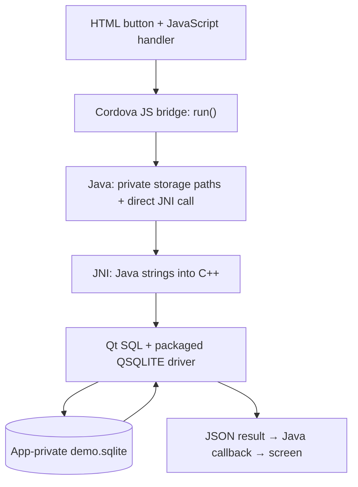
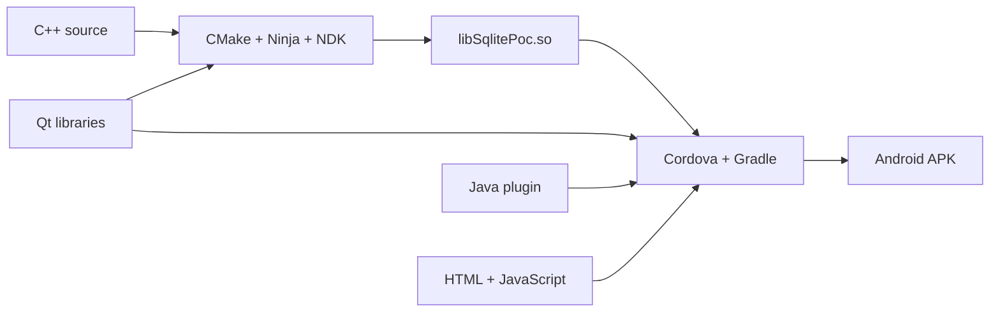

# Qt SQLite on Android — minimal Cordova PoC

## Follow the code



| Layer | Responsibility | Source |
| --- | --- | --- |
| Frontend | Enable the button after Cordova is ready; show the result; disable while pending | [HTML](www/index.html), [JavaScript](www/js/index.js) |
| Cordova bridge | Route one method to service `SqlitePoc`, action `run` | [SqlitePoc.js](native-plugin/www/SqlitePoc.js) |
| Android Java | Supply private storage and native-library paths; call JNI directly; deliver the callback | [SqlitePoc.java](native-plugin/src/android/SqlitePoc.java) |
| JNI and Qt C++ | Convert strings; load the driver; create, insert, close, reopen and select; clean up the connection | [SqlitePoc.cpp](native-plugin/src/android/SqlitePoc.cpp) |

## Build stages



## Build and run on Windows

Your PC needs:

- Python 3.10+ (64-bit).
- JDK 21, with `JAVA_HOME` set to its installation directory.
- Node.js/npm and the Cordova CLI.
- Android SDK 36, platform-tools and command-line tools (`cmdline-tools/latest`), with `ANDROID_HOME` set to the SDK directory.

From the project directory, run:

```powershell
./build.ps1
```

The script installs the required Qt/C++ tools automatically and builds the app. Use the same command after changing native/plugin code.

## Run App
```powershell
cordova run android --device
```

