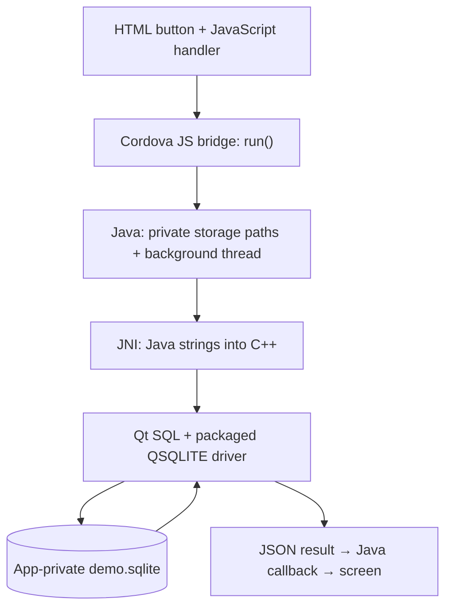

# Qt SQLite on Android — minimal Cordova PoC

## Follow the code



| Layer | Responsibility | Source |
| --- | --- | --- |
| Frontend | Enable the button after Cordova is ready; show the result; disable while pending | [HTML](www/index.html), [JavaScript](www/js/index.js) |
| Cordova bridge | Route one method to service `SqlitePoc`, action `run` | [SqlitePoc.js](native-plugin/www/SqlitePoc.js) |
| Android Java | Supply private storage and native-library paths; run work off the UI thread; deliver the callback | [SqlitePoc.java](native-plugin/src/android/SqlitePoc.java) |
| JNI and Qt C++ | Convert strings; load the driver; create, insert, close, reopen and select; clean up the connection | [SqlitePoc.cpp](native-plugin/src/android/SqlitePoc.cpp) |


## Build on Windows

Baseline: Qt **6.12.0** Android ARM64 plus its desktop host kit, NDK **27.2.12479018**, native API **28**, JDK **21**, CMake **3.25+**, Ninja, Node.js and Cordova CLI. Cordova Android **15.1.0** uses Android SDK 36. Only Android ARM64 is packaged.

Set `JAVA_HOME` and `ANDROID_HOME` for your machine. From this directory, build and stage the native libraries **before installing/restoring the plugin**:

```powershell
./scripts/build-native.ps1 -QtAndroidPath C:/Qt/6.12.0/android_arm64_v8a -QtHostPath C:/Qt/6.12.0/mingw_64 -NdkPath "$env:ANDROID_HOME/ndk/27.2.12479018" -CMake cmake -Ninja ninja
npm ci
cordova prepare android
cordova build android --debug
```

The script accepts full executable paths if CMake or Ninja is not on PATH. It stages the native PoC library, Qt Core, Qt SQL, QSQLITE driver, C++ runtime and Qt Android JAR under ignored `native-plugin/src/android/libs/`. The Gradle fragment enables extraction of the native libraries so Qt can load its driver by absolute path.

After editing native/plugin source, rebuild and reinstall the plugin copy before rebuilding Android:

```powershell
./scripts/build-native.ps1 -QtAndroidPath C:/Qt/6.12.0/android_arm64_v8a -QtHostPath C:/Qt/6.12.0/mingw_64 -NdkPath "$env:ANDROID_HOME/ndk/27.2.12479018"
cordova plugin remove cordova-plugin-sqlite-poc
cordova plugin add ./native-plugin
cordova build android --debug
```

APK: `platforms/android/app/build/outputs/apk/debug/app-debug.apk`.

```powershell
adb devices -l
adb -s DEVICE_SERIAL install -r platforms/android/app/build/outputs/apk/debug/app-debug.apk
adb -s DEVICE_SERIAL shell am start -n com.example.sqlitepoc/.MainActivity
```

